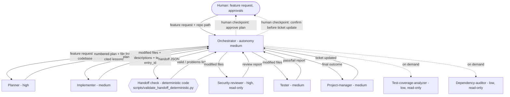

# Orchestration Diagram: todo-list-python (8 roles)

The orchestrator (the main Claude session) delegates to scoped subagents. Each arrow says what is handed down and what comes back. The handoff check is deterministic code, and the human checkpoints are marked.

## Role summary

| Role | Responsibility | Autonomy | Workspace |
|---|---|---|---|
| Orchestrator | Decompose, delegate, evaluate, assemble | medium | read-write |
| Planner | Ordered plan and file list | high | read-only |
| Implementer | Write the code in the plan | medium | read-write |
| Security-reviewer | Report problems, never edit | high | read-only |
| Tester | Run tests, report pass/fail | medium | read-only |
| Project-manager | Update the ticket only | medium | read-only |
| Test-coverage-analyzer | Recommend tests (on demand) | not declared in file; policy sets low | read-only |
| Dependency-auditor | Report risky dependencies (on demand) | low | read-only |

## Agent, deterministic code, or human
- **Agent:** planner, implementer, security-reviewer, tester, project-manager, test-coverage-analyzer, dependency-auditor (judgment or synthesis).
- **Deterministic code:** the handoff check (ADR-003, Proposed), the MCP allow-list and classification checks, the policy test suite.
- **Human:** plan approval and ticket confirmation. A subagent cannot confirm human approval, so the main session plays the orchestrator for real checkpoints.

## Limits
- The tester's `test_runner` returns placeholder PASS output, so test results are unverified.
- The handoff check is wired as orchestrator step 2a, but the orchestrator has no shell tool to run it.
