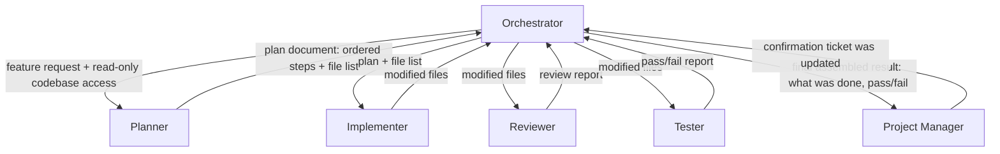

# Orchestration Diagram: CSV Export Feature (Practice Example)

Alt text: A diagram showing the Orchestrator at the top, connected by arrows to five subagents arranged below it: Planner, Implementer, Reviewer, Tester, and Project Manager. Each arrow is labeled with what is handed down to the subagent and what is returned back up to the Orchestrator.

## Role Summary

| Role | Responsibility | Tools | Autonomy |
|---|---|---|---|
| Planner | Produce a short, ordered plan + file list for the CSV export feature | Read, codebase search | High |
| Implementer | Write the code described in the plan | Read, write, codebase search | Medium |
| Reviewer | Read proposed changes, flag problems (no edits) | Read, codebase search | High (read-only) |
| Tester | Run the test suite, report pass/fail | Read, test runner | Medium |
| Project Manager | Update the ticket's status to reflect the outcome | Ticket-tracking tool only | Medium |

5 subagent roles defined, each with exactly one responsibility, a scoped tool set, and an explicit autonomy level based on the cost of a mistake rather than speed.
